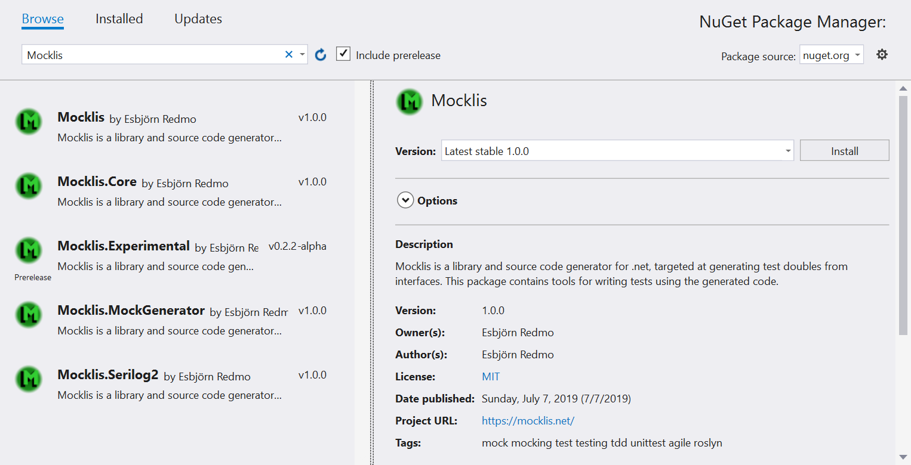

============
Installation
============

The quick version
-----------------

Add the ``Mocklis`` NuGet package to your test project.

This can be done with the NuGet browser in Visual Studio: Search for 'Mocklis' while on the Browse tab, and you should see the Mocklis
packages and be able to add ``Mocklis`` to your project.

The slightly longer version
---------------------------

There are three things that you'll need to get hold of to run Mocklis.

Firstly there is a source generator that builds test double classes from interface definitions. This is the ``Mocklis.MockGenerator``
package.

The generated source code does depend on a bunch of types in order for it to compile. These can be found in the ``Mocklis.Core`` package.

Then there is a library of pluggable 'steps' which provide bite-sized behaviours to the test doubles, along with some supporting
code. These live in the ``Mocklis.BaseApi`` package.

All of these packages can be installed in one go by using the ``Mocklis`` meta-package.

There's also ``Mocklis.Experimental`` for steps whose design is still under development (read: steps that simply haven't been axed yet...)
and ``Mocklis.Serilog2``, ``Mocklis.Serilog3`` and ``Mocklis.Serilog4`` which contain logging providers for Serilog 2.x, 3.x and 4.x respectively.

Note that ``Mocklis.Experimental`` is going to stay a perpetual pre-release, so that it can have breaking changes without violating
the semantic versioning rules. You'll need to tick the checkbox that says 'Include prerelease' to see it.

